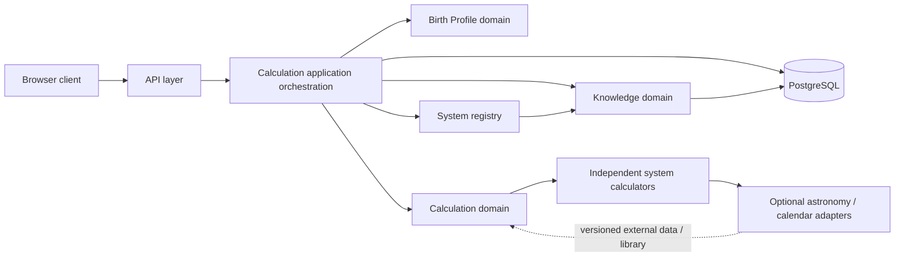

# Calculation engine architecture

## Status and scope

This document describes a proposed modular monolith. It does not describe code
that has already been implemented. The current backend is a Spring Boot 3.5.6 /
Java 21 application with a health endpoint, shared error response, CORS
configuration, and a Flyway-created `astrology` schema. The browser still owns
all birth-date calculations. No calculation modules, profile domain, or
calculation API are implemented today.

The existing UI and behavior are documented in the root `README.md`; the
current algorithms are in `script.js`. The current frontend submits only a
date formatted as `DD/MM/YYYY`, then computes all 12 displayed results locally.

## Proposed modular monolith

Keep one deployable Spring Boot application and one PostgreSQL database. Divide
the application by domain responsibility, not by deployment or technical
layer. Modules should expose narrow application-facing ports; one tradition's
calculator must not import or call another tradition's calculator.

### Domain responsibilities

| Module | Owns | Must not own |
|---|---|---|
| Birth Profile | Validated civil date, optional local time, optional place and IANA timezone, time accuracy, normalization and provenance of coordinates | Sign interpretation, sign lookup tables, implicit midnight or coordinate guesses |
| Calculation | Calculator registry, requirement checks, orchestration, statuses, normalized results, methodology/version/uncertainty metadata | Personality prose, persistence of anonymous requests, one universal calendar rule |
| Knowledge | Curated system/sign identifiers, labels, symbols, elements/modalities/rulers when applicable, sourced interpretations, historical context and attribution | Astronomy or calendar arithmetic, inferred birth-chart results |
| API | HTTP contracts, request constraints, transport mapping, response normalization and stable error format | Domain calculations or content selection rules |
| Infrastructure adapters | PostgreSQL, optional ephemeris/calendar libraries, coordinate resolution if explicitly introduced | Silently supplying missing birth data or hiding provider errors |

Knowledge is related to, but independent of, calculation output. A result
classification should use a stable classification identifier; the API can
enrich it with a knowledge record. If content is unavailable, the calculation
result remains valid and reports the missing enrichment rather than inventing
interpretation text.

### Calculation flow

1. Parse and validate the JSON request and ISO date/time values.
2. Resolve known system IDs and reject unknown IDs at the API boundary.
3. Normalize only explicit input. Preserve the local civil date/time, named
   timezone, location provenance, and accuracy rather than coercing input to
   UTC prematurely.
4. For each requested system, independently compare the profile with that
   system's declared requirements.
5. Return `INSUFFICIENT_INPUT` or `UNSUPPORTED` without invoking a calculator
   when requirements or implementation are unavailable.
6. Invoke each supported calculator through the common contract. A system
   failure is isolated to that result; it must not cause another system to
   return a plausible-looking default.
7. Attach the calculator's status, completeness, methodology identifier and
   version, warnings, and limitations; enrich with separately sourced
   knowledge where available.
8. Return a calculation response. Do not persist the birth profile or result
   unless a later, explicit saved-profile feature is designed and consented to.

## Calculator contract (conceptual; no Java types are created here)

`AstrologySystemCalculator` is a useful conceptual port. It should define:

- A stable `systemId` and a discoverable descriptor.
- `InputRequirements`: required and optional fields, supported date ranges,
  calendar/timezone/location needs, and precision/accuracy policy.
- Input validation that returns structured validation issues rather than
  throwing for expected missing or invalid data.
- Calculation execution over a validated/normalized profile and a
  calculation context (methodology configuration, ephemeris/calendar provider,
  and reproducibility inputs).
- A normalized result containing a stable classification ID, display label
  (or a knowledge reference), optional structured values, status,
  completeness, methodology/version, warnings, and limitations.
- Explicit failure mapping. Unexpected exceptions become
  `CALCULATION_ERROR` for that system, with a correlation identifier and safe
  public message; internal logs retain diagnostic context without birth data.

The orchestration layer depends on this port and registry only. New systems
are registered by adding their descriptor and module implementation, not by
changing orchestration branching. System-specific date/calendar logic remains
within that module or a shared, well-defined infrastructure adapter.

## Status and completeness model

Every requested system produces one result entry, including failures.

| `status` | Meaning |
|---|---|
| `SUCCESS` | A result was calculated under the declared method. It may still be partial; see `completeness`. |
| `INSUFFICIENT_INPUT` | The request is structurally valid but omits an input the system requires. |
| `UNSUPPORTED` | The system is known but has no enabled implementation for this deployment or requested method. |
| `INVALID_INPUT` | The profile or a system-specific value violates a domain constraint. Malformed request shape/date is normally an HTTP 400 before orchestration. |
| `CALCULATION_ERROR` | A calculator/provider failed unexpectedly or could not produce a result. Never substitute a default classification. |

`completeness` is separate: `COMPLETE`, `PARTIAL`, or `NONE`. `SUCCESS` with
`PARTIAL` is allowed only when the method deliberately returns a useful,
qualified subset (for example, a date-only output where an optional chart
feature needs time). Include warnings that explain omissions. A failed result
has `NONE`; no output classification should be emitted for a status other than
`SUCCESS`.

The registry's deployment status (for example `NOT_IMPLEMENTED`,
`EXPERIMENTAL`, `AVAILABLE`) is not the same as a request's calculation
status. Do not report the current browser-only logic as an available backend
calculator.

## Birth profile policy

The canonical API representation is described in
[`api-contract.md`](./api-contract.md). A date is required. Time, birthplace,
timezone, and time accuracy are optional fields, but a calculator may require
some of them.

- Use `LocalDate`-equivalent semantics for ISO `YYYY-MM-DD`; it is a civil
  calendar date, not an instant.
- Use a local ISO time (`HH:mm[:ss]`) only together with an explicit IANA
  timezone for instant-sensitive calculations. Do not treat a bare local time
  as UTC or server time.
- Timezone may be supplied independently of the place. A place name alone
  does not resolve uniquely to coordinates or a timezone.
- Place is a user-provided label and, when needed, explicitly provided
  latitude/longitude/elevation. Do not geocode implicitly or fabricate
  coordinates from a place string.
- If time or timezone is absent, do not assume midnight, noon, or the server's
  timezone. A date-only method can proceed; an instant-sensitive module returns
  `INSUFFICIENT_INPUT`, or a documented partial interval result if it truly
  supports one.
- `timeAccuracy` is `EXACT`, `APPROXIMATE`, or `UNKNOWN`. It describes the
  time-of-birth value, not algorithm precision. `UNKNOWN` is the default when
  a time is not given; it does not mean midnight.
- Keep original local inputs and the normalization method available for
  reproducibility. Avoid logging or retaining them by default.

## Accuracy and reproducibility rules

1. **Boundaries:** Represent astronomical boundaries as instants or
   half-open intervals `[start, end)` in a declared time scale. Avoid
   inclusive date-range tables as an engine of record. Resolve exact crossings
   under a declared timezone and boundary policy. When input accuracy straddles
   a boundary, mark uncertainty/partial rather than picking a side arbitrarily.
2. **Leap years and civil calendars:** Validate actual Gregorian dates,
   including leap days. Declare proleptic Gregorian handling for historic
   dates; do not silently claim it is the historical local calendar. Identify
   Julian/Gregorian transition conventions where relevant.
3. **Timezone:** Use IANA timezone identifiers and a versioned timezone
   database. Local historical offsets/DST can be uncertain or unavailable;
   preserve that uncertainty. Convert to an instant only after resolving
   explicit zone and local time.
4. **Calendar conversions:** Each system owns its calendar choice, epoch,
   correlation, day boundary, leap/intercalation policy, region, and source.
   Do not share a Chinese, Tibetan, Mayan, or Aztec conversion merely because
   they are cyclical calendars.
5. **Astronomy:** Specify geocentric/topocentric frame, apparent/mean
   coordinates, ecliptic/equinox, ayanamsa where relevant, time scale, and
   precision. A high-precision planet position does not establish a tradition's
   interpretive or historical validity.
6. **Ephemerides:** Pin library release, data set, configuration, and coverage.
   Surface missing/out-of-range data; do not silently switch to a lower-grade
   ephemeris.
7. **Reproducibility:** Every result includes a methodology ID and immutable
   version, calculator version, relevant calendar/correlation or ephemeris
   release, and input-normalization metadata. A methodology change creates a
   new version; never rewrite prior meanings under the same version.
8. **Tests:** Maintain golden/reference cases for boundary instants, just
   before/at/after boundaries, leap dates, timezone transitions, supported
   calendar epochs, and unsupported input. Record the source and uncertainty
   for each expected value. Cross-check astronomy against independent
   ephemerides/reference tools; do not use the legacy frontend output as the
   truth oracle.

### Astronomy library evaluation

- **Swiss Ephemeris:** Its official documentation describes a high-precision
  ephemeris, Julian-day/time-scale inputs, and downloadable ephemeris data. It
  is a candidate for astrology-oriented planetary calculations. The project
  states a dual license: AGPL or a commercial Swiss Ephemeris Professional
  License, with obligations that can affect the whole application or public
  service. Legal review and deployment/data-file review are prerequisites;
  do not add it until license choice is approved.
  [Official overview and licensing](https://www.astro.com/swisseph/swephinfo_e.htm)
  · [Programmer's manual](https://www.astro.com/swisseph/swephprg.htm)
- **Astronomy Engine:** The upstream project documents Sun, Moon, planet,
  coordinate and event calculations, roughly ±1 arcminute stated accuracy,
  tests against NOVAS/JPL Horizons, and an MIT license. It has Kotlin alongside
  JavaScript, C, C#, and Python support; verify present JVM interoperability,
  release, and exact API before selection. Its stated precision and model
  coverage may suit some use cases but should not be assumed sufficient for
  every sign-boundary or historical question.
  [Upstream project](https://github.com/cosinekitty/astronomy)
  · [MIT license](https://raw.githubusercontent.com/cosinekitty/astronomy/master/LICENSE)

Neither library performs the historical research, calendar-convention
selection, or interpretation that these traditions require. Initial date-only
calendar modules do not necessarily need an astronomical dependency.

## Persistence

Keep calculation execution dynamic by default. Persist curated, versioned
system descriptors, knowledge entries, interpretation text, source references,
and methodology descriptions where they need editorial management and
publication history. Seed/static resources are also reasonable for a small,
read-only initial catalog; make that decision based on editorial workflow, not
because JPA is already on the classpath.

Do not persist anonymous birth profiles or every calculation. In a later
explicit saved-chart feature, store profiles/results only with clear user
consent, retention/deletion rules, access controls, and a versioned calculation
snapshot. A reproducibility record must not require retaining unnecessary
personal data; decide whether it stores exact input, a user-owned profile
reference, or a redacted audit record. Never use raw birth details in
application logs or analytics.
